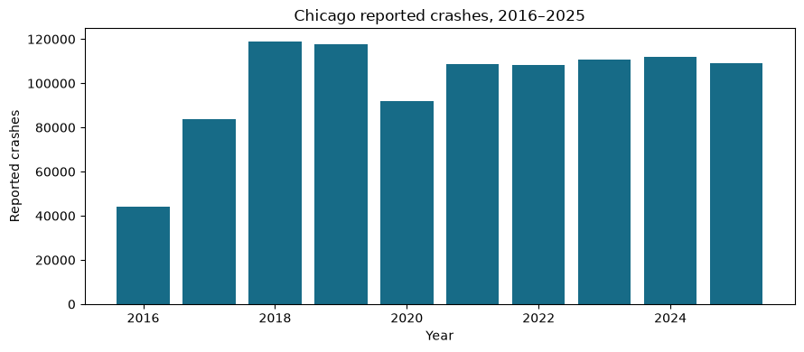
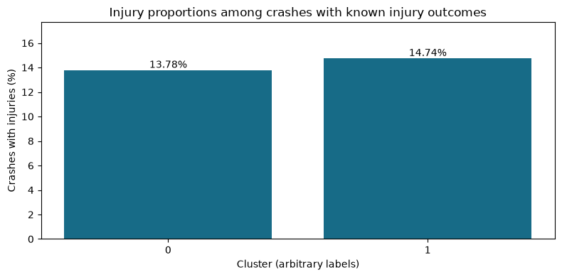
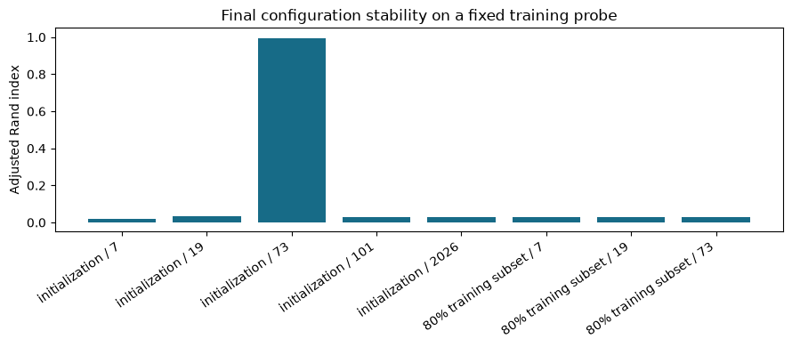

# Chicago Traffic Crash Analysis

**Daniel Alejandro Berrio Restrepo** · Python · Polars · K-Prototypes

An exploratory study of reported Chicago crashes during **2016–2025**, combining data auditing, descriptive analysis and clustering of mixed numerical and categorical crash circumstances.

[Open the executed notebook](notebooks/chicago_traffic_analysis.ipynb) · [Official data source](https://data.cityofchicago.org/Transportation/Traffic-Crashes-Crashes/85ca-t3if/about_data) · [Execution details](reports/execution_summary.json)

## Questions

- Which road, environmental and crash circumstances form distinct descriptive profiles?
- How do injury proportions differ across these profiles?
- How sensitive are the groups to K, gamma, numerical preprocessing, initialization and training samples?
- Are the frozen model's profiles consistent between training and held-out evaluation records?

## Data and integrity

The source is the City of Chicago's **Traffic Crashes – Crashes** dataset (ID `85ca-t3if`). The supplied snapshot contains **1,099,438 records and 49 columns**; **1,006,003** fall within 2016–2025. The original CSV is excluded from this repository. Live downloads may differ because the portal is updated.

The execution scanned every record with strict CSV quoting and checked field counts, then loaded the complete file with Polars without ignoring errors. It checked unique crash IDs, strict datetime/numeric parsing, missingness and selected semantic conditions. CSV syntax validity does not guarantee factual accuracy.

- Malformed record widths: **0**. No CSV repair, row skipping or field imputation was performed.
- Outside the study period: **93,435** records, intentionally excluded.
- Missing/nonfinite model features: **0** records explicitly excluded.
- Final modeled population: **1,006,003** crashes.
- Missing injury outcomes in the modeled population: **2,189**, retained for clustering and excluded from injury-rate denominators.
- Zero-coordinate records in the complete source: **74**; coordinates are not clustering inputs.

The exact file fingerprint and checks are in [the integrity report](reports/integrity.json). The original notebook was revised with the author's authorization; [provenance](reports/provenance.json) records its hash and the changes. Neither original input was modified.

Citywide coverage starts in September 2017; early counts are not directly comparable with later full-coverage years.

## Method

Polars handles schema inspection, strict parsing, filtering, category normalization and grouping. Numerical features are posted speed limit and number of units; categorical features are time of day, weather, lighting, roadway surface, traffic control, trafficway type, first crash type and alignment. Unknown/not applicable categories remain explicit. Injuries are used only after clustering.

The notebook samples **30,000 training and 5,000 evaluation records without replacement** before fitting transformations. Each fit uses ten Huang initializations and up to 100 iterations, retaining the lowest-cost solution; this increases the optimization budget after an exploratory two-initialization run showed instability. Median/IQR scaling, with a training-standard-deviation fallback for zero IQR, is fitted on training only. The primary configuration clips scaled numerical features to [-4,4].

K-Prototypes combines squared numerical distance with gamma-weighted categorical mismatches. **Gamma=2** is a prespecified reference from the supplied notebook's final configuration, giving a categorical mismatch weight of two relative to squared scaled numerical differences. It is not claimed universally optimal. At that fixed gamma, K=2–5 are compared on a fixed 1,000-record training probe using the same mixed dissimilarity. The selected **K=2** maximizes this exploratory silhouette among configurations with at least 1% training membership in every group. Costs are compared only within the same feature treatment and gamma.

[Configuration comparison](reports/configurations.csv) and [sensitivity results](reports/sensitivity.csv) cover gamma=0.5,1,2,4 and removing clipping. Cross-gamma silhouettes are diagnostic, not a common optimization scale. Five additional initialization seeds and three 80% training subsamples assess agreement on a fixed training probe via adjusted Rand index (ARI).

The frozen model is then applied to held-out evaluation records. [Training/evaluation comparisons](reports/train_evaluation.csv) include cluster shares and injury proportions; the notebook also reports mean assigned dissimilarity. Evaluation is not used to choose K, gamma or a seed. Final population labels are assigned in batches and joined by unique crash ID, with one-to-one validation and an independent 1,000-record prediction spot check.

## Results from the completed execution

| Cluster | Crashes | Known injury outcomes | Crashes with injuries |
|---|---:|---:|---:|
| 0 | 329,743 | 328,337 | 13.78% |
| 1 | 676,260 | 675,477 | 14.74% |

Cluster labels are arbitrary and cannot be matched numerically to the earlier notebook. Injury percentages use known injury totals as denominators and count a crash as having injuries when `INJURIES_TOTAL > 0`. [Numerical profiles](reports/population_profiles.csv) and [categorical modes and their shares](reports/categorical_profiles.csv) support interpretation.

- **Cluster 0:** modal crash type, trafficway and time period are PARKED MOTOR VEHICLE (41.5%); NOT DIVIDED (36.4%); EVENING (56.8%). Mean posted road limit: 25.5 mph; mean units: 2.04.
- **Cluster 1:** modal crash type, trafficway and time period are REAR END (28.0%); NOT DIVIDED (45.9%); AFTERNOON (57.4%). Mean posted road limit: 29.8 mph; mean units: 2.03.

The population injury-proportion spread is **0.96 percentage points**. Between training and held-out evaluation, the largest cluster-share difference is **0.23 percentage points** and the largest within-cluster injury-proportion difference is **0.54 percentage points**. Mean assigned dissimilarity is **7.258** for training versus **7.213** for evaluation. These are descriptive comparisons.

**Stability limitation:** the partition remains sensitive to initialization or training-sample changes despite ten initializations. Treat these profiles as provisional descriptive partitions, not robust natural crash categories.

Gamma alternatives yield ARI values from **0.117 to 0.148** against the reference; gamma therefore materially affects the partition.

Initialization stability ARI ranges from **0.020 to 0.996**; the 80% training-subset range is **0.031 to 0.031**. The agreement ranges describe the tested runs and do not establish a unique or externally validated clustering. Full per-experiment values are [recorded here](reports/stability.csv).

## Run in Google Colab

1. Download a CSV export from the [official Chicago dataset](https://data.cityofchicago.org/Transportation/Traffic-Crashes-Crashes/85ca-t3if/about_data). For exact comparisons, use the audited snapshot identified in `reports/integrity.json`; the current export may have changed.
2. In Colab, choose **File → Open notebook → GitHub**, paste `https://github.com/daniel19512/chicago-traffic-crash-analysis`, and open `notebooks/chicago_traffic_analysis.ipynb`. Clone the repository in a setup cell with `!git clone https://github.com/daniel19512/chicago-traffic-crash-analysis.git /content/chicago-traffic-crash-analysis`, or upload its contents instead.
3. Install the recorded dependencies in a setup cell: `%pip install -r /content/chicago-traffic-crash-analysis/requirements.txt`. Restart the runtime after installing if needed.
4. Upload the CSV to `/content/data/Traffic_Crashes_-_Crashes_20261001.csv`, or mount your own Drive and set the `CHICAGO_CSV` environment variable to your file. For example, use `%env CHICAGO_CSV=/content/data/Traffic_Crashes_-_Crashes_20261001.csv` in a setup cell. The notebook's default is a configurable example path; no personal Drive path is included.
5. Change the working directory to `/content/chicago-traffic-crash-analysis/notebooks` with `%cd`, then run all notebook cells in order. A CPU runtime is sufficient; multiple fits on 30,000 records can take substantial time. Use a runtime with enough memory for the full CSV. Figures and reports are regenerated in `assets/` and `reports/`.

For local execution, create a Python virtual environment, install `requirements.txt`, set `CHICAGO_CSV`, and run the notebook in a fresh kernel. The recorded execution used Python **3.12.14**. Dependency pins in this repository are observed installed versions from that execution, not a claim of testing every platform or Colab runtime.

## Validation and limits

The notebook was executed from its first to its final code cell in a newly created isolated Python environment using the supplied CSV. Its saved outputs are from that run. Explicit checks cover strict CSV loading, unique IDs, disjoint training/evaluation IDs, fitting transformations on training only, prediction lengths, one-to-one label joins and prediction spot checks. Static checks separately validate notebook JSON/schema, Python syntax, repository content and relative README links. See [validation details](reports/validation.json).

- These are descriptive associations, not causal effects or exposure-adjusted crash risks. There are no traffic volume, trip, vehicle-mile or pedestrian denominators.
- The official source states that citywide reporting begins in September 2017. Counts for 2016 and part of 2017 have partial geographic coverage. Crashes outside CPD response jurisdiction, often interstate highways, are excluded. Annual counts alone cannot establish trends in underlying safety.
- Groups depend on features, preprocessing, K, gamma and random sampling. Stability checks are limited experiments, not proof of a unique partition.
- The earlier notebook calculated scaling before splitting, so its evaluation was not fully independent. This revision fits scaling on training only, but the snapshot has already informed project development. The random holdout is an internal descriptive check, not temporal or external predictive validation.
- Posted speed limit is the permitted road limit, **not actual vehicle speed**.
- No causal effect, measured business impact, deployed model or external predictive performance is claimed.

No license has been added. The data remains subject to the source portal's applicable terms.
